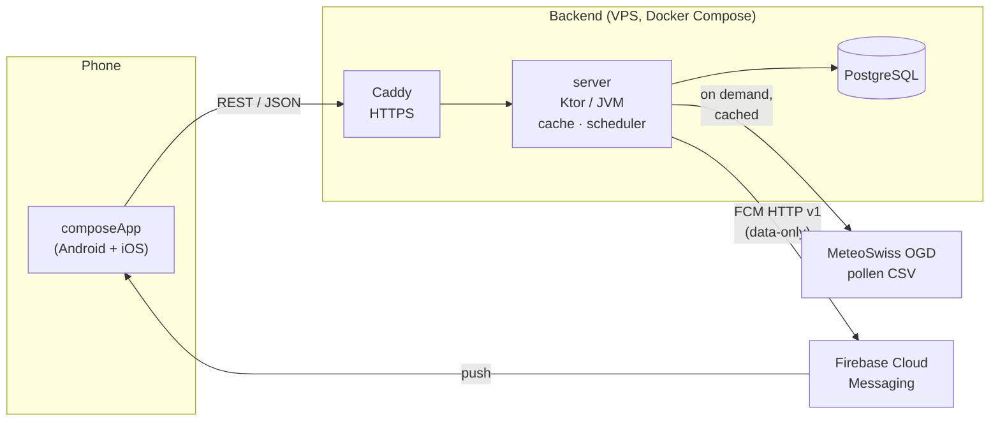
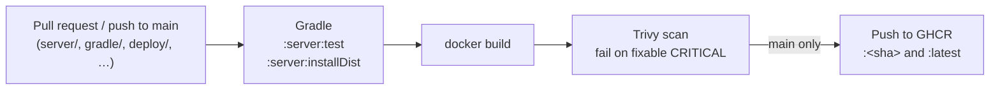
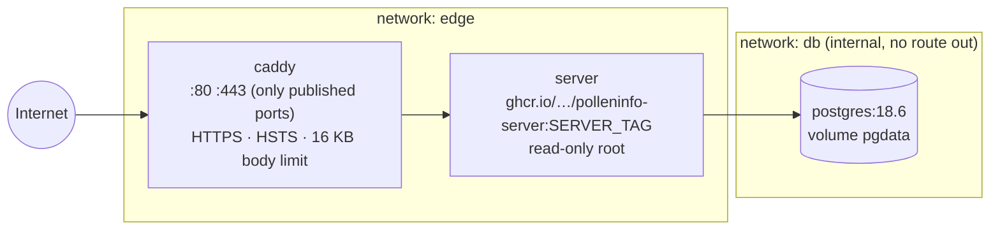

# PollenInfo

Swiss pollen levels per measuring station, on Android and iOS — with daily reports and threshold
alarms as push notifications, and a diary that sets how you felt against the pollen in the air.

PollenInfo is a [Compose Multiplatform](https://www.jetbrains.com/compose-multiplatform/) app and a
[Ktor](https://ktor.io/) backend. The backend is the only part that talks to the
[MeteoSwiss open pollen data](https://opendatadocs.meteoswiss.ch/a-data-groundbased/a7-pollen-stations);
the apps speak only to our own REST API at `https://api.polleninfo.ch`.

> Source: MeteoSwiss. PollenInfo is independent and not affiliated with or endorsed by MeteoSwiss.

---

## Contents

- [Features](#features)
- [Architecture](#architecture)
- [Tech stack](#tech-stack)
- [Getting started](#getting-started)
- [Testing](#testing)
- [CI](#ci)
- [Deployment](#deployment)
- [Further reading](#further-reading)

---

## Features

The app has five tabs:

| Tab | What it does |
| --- | --- |
| **Home** | The current reading of your station: the overall severity and one bar per pollen type, how old the reading is (with a clear warning once it is three hours old or more), pull-to-refresh, and once a day the question *"How do you feel today?"* |
| **All stations** | All 15 Swiss stations at a glance: a map of Switzerland with one coloured dot per station and a list that fills in station by station. Tap a dot or a row to see that station's full reading. |
| **Diary** | Your answers to *"How do you feel today?"* drawn against the daily pollen levels of a station you choose, over the last week, month or year — one line per pollen type, filterable. Needs an account. |
| **Alarms** | Up to ten alarms per install, each either a **daily report** (e.g. "at 08:00, Mon–Fri") or a **threshold alert** (e.g. "between 07:00 and 21:00, when birch or grasses reach High"). Delivered as push notifications on Android. |
| **Settings** | Default station, account (log in, log out, delete), language, Impressum, data-source attribution and version. |

And throughout:

- **Seven pollen types** — alder, birch, hazel, beech, ash, oak and grasses — classified into five
  severities (*None, Low, Moderate, High, Very high*) by per-species thresholds that live in the
  backend.
- **Four languages** — English, German (Swiss Standard German), French and Italian, switchable
  in-app. Push notifications are worded on the phone, in the app's language.
- **Nearest station** — onboarding and the station picker can propose the closest station from a
  coarse location fix; the coordinates never leave the device.
- **Accounts without tracking** — email and password only, used for nothing but logging in. Readings,
  All stations and alarms need no account; alarms belong to the install, anonymously.
- **Accessibility** — every severity is a word as well as a colour, colour palettes are checked for
  contrast in light and dark mode, and charts and maps have spoken descriptions.

---

## Architecture



### The backend owns all upstream contact

Fetching, CSV parsing (ISO-8859-1, `;`-separated), station metadata and severity classification
live in `:server`. The apps never call MeteoSwiss and never classify a concentration — they render
what the server computed.

- **On demand, cached.** A station's current-day file is fetched only when someone asks for that
  station and the server has no reading younger than **30 minutes**. Any number of users looking
  at one station cost one upstream request per period; simultaneous first requests share a single
  fetch. The Diary's daily history is a second cache on the same terms (3 h for the current year,
  24 h for earlier years).
- **Honest through outages.** If MeteoSwiss fails, the last good reading is served with its
  **original** timestamp, and the app's stale-reading warning makes its age visible.
- **One timer: the alarm scheduler.** Once a minute it reads a station only if an enabled alarm
  needs it — a daily report due that minute or a threshold window that is open — through the same
  cache. Missed minutes are caught up for two minutes after a restart, never longer; each pollen
  type alerts at most once per alarm per Swiss day.
- **"What happened", not text.** Pushes are data-only FCM messages (kind, station, levels); the
  Android app words them in the user's language.

### Modules

| Module | Type | Contains |
| --- | --- | --- |
| [`androidApp`](androidApp) | Android application | The APK: `MainActivity`, the manifest, icons, build types and the backend address per build, Firebase config, Crashlytics mapping upload, R8 rules |
| [`composeApp`](composeApp) | KMP library (Android, iOS) | All app code: UI, ViewModels, repositories, REST client, push service, platform actuals, all app tests |
| [`theme`](theme) | KMP library (Android, iOS) | Material 3 colours and typography, plus the severity, species and map palettes |
| [`server`](server) | Kotlin/JVM (Ktor + Netty) | REST API, station / species / threshold domain, MeteoSwiss fetching, alarm scheduler, accounts and diary, PostgreSQL store |

### Inside the app

Each feature in `composeApp` is a vertical slice — `data/` (API service, DTOs, mapper, repository)
→ `domain/` (models, repository interface, use cases) → `presentation/` (screen, ViewModel, UI
state). Code shared by several features moves into `core/` with the same layering.

- **Unidirectional state:** one sealed `UiState` per screen (`Loading` / `Content` / `Error`),
  exposed as a single `StateFlow`; one-shot actions such as navigation are events on a `Channel`.
- **Errors never escape the data layer:** repositories return a `Result`, and screens show an
  `AppError` worded from string resources — never an exception message.
- **Koin** for dependency injection, **type-safe Compose Navigation** for routes, **DataStore** for
  the few things the phone remembers (selected station, device token, login).

### Inside the server

```
server/src/main/kotlin/ch/stenzel/tim/polleninfo/server/
├── config/    environment → ServerConfig, every problem reported at once
├── plugins/   serialization, logging, security (rate limits, body limit), auth, routing
├── pollen/    domain enums & thresholds, upstream fetch + CSV parser, TTL cache, history
├── alarm/     devices & alarms, scheduler, pure alarm rules, FCM sender
└── account/   validation, Argon2id hashing, sessions, diary
```

- **Security:** two bearer-token schemes (anonymous device tokens for alarms, session tokens for
  accounts), only SHA-256 hashes stored; per-address and per-principal rate limits; 16 KB body limit;
  no token, email or body ever logged.
- **Persistence:** PostgreSQL 18 through Exposed, schema owned by Flyway migrations
  ([`db/migration`](server/src/main/resources/db/migration)). The server runs as a role that can
  read and write rows but cannot create, alter or drop a table.

### REST API at a glance

| Path | Purpose |
| --- | --- |
| `GET /health` | Liveness |
| `GET /pollen/stations`, `/pollen/stations/{abbr}` | Station list and metadata |
| `GET /pollen/stations/{abbr}/measurements` | Latest reading, classified |
| `GET /pollen/stations/{abbr}/history?range=week\|month\|year` | Daily means, classified |
| `GET /pollen/species`, `/pollen/thresholds` | Vocabulary and severity bands |
| `POST /devices`, `/devices/me/…` | Anonymous device registration, push address, alarms (CRUD) |
| `POST /users`, `/users/session`, `/users/me/…` | Accounts, sessions, account deletion, diary |

The full contract, with every status code, is in [`CLAUDE.md`](CLAUDE.md#rest-api).

---

## Tech stack

| Area | Choice |
| --- | --- |
| Language | Kotlin 2.4 |
| App UI | Compose Multiplatform 1.12, Material 3 |
| App plumbing | Ktor Client, Koin, kotlinx.serialization, kotlinx-datetime, DataStore, Navigation Compose |
| Android | AGP 9.4, minSdk 26, targetSdk 37, Firebase Cloud Messaging, Firebase Crashlytics (release builds only), Credential Manager |
| Server | Ktor 3.6 on Netty, Exposed, HikariCP, Flyway, Bouncy Castle (Argon2id), Logback |
| Database | PostgreSQL 18 |
| Infrastructure | Docker Compose, Caddy, GitHub Actions, GHCR, Trivy, Dependabot |
| Tests | `kotlin.test`, coroutines-test, Ktor `MockEngine` / test host, Testcontainers |

---

## Getting started

### Prerequisites

- JDK 21 (Android Studio's bundled JBR works)
- Android SDK (Android Studio)
- Docker — Docker Desktop, OrbStack or Colima — for the development database and the server tests
- Full Xcode only if you want to run the iOS tests (there is no iOS app project yet)

### Run the backend

```sh
docker compose -f deploy/compose.dev.yaml up -d   # PostgreSQL with the development roles
./gradlew :server:run                             # http://localhost:8080
curl http://localhost:8080/health                 # OK
```

No environment variables are needed: the development defaults match
[`deploy/compose.dev.yaml`](deploy/compose.dev.yaml) and its committed development passwords in
[`deploy/dev-secrets`](deploy/dev-secrets). Without `FCM_CREDENTIALS`, pushes are logged instead of
sent. Reset the database with `docker compose -f deploy/compose.dev.yaml down -v`.

### Run the Android app

```sh
./gradlew :androidApp:assembleDebug
```

A debug build talks to `http://10.0.2.2:8080` — the emulator's alias for your machine. To point it
elsewhere, pass `-Ppolleninfo.apiBaseUrl=https://api.polleninfo.ch` (or set it in
`~/.gradle/gradle.properties`). A release build always uses `https://api.polleninfo.ch`.

A release build reports fatal crashes and ANRs to Firebase Crashlytics (debug builds never do) and
uploads its R8 mapping so the stack traces are readable. That upload needs network access; for an
offline or quick local release pass `-Ppolleninfo.uploadCrashlyticsMapping=false` and accept that
its crashes stay obfuscated. The manual end-to-end check is in
[`deploy/README.md`](deploy/README.md#crash-reporting-manual-check).

On an **Android 17 (API 37)** emulator, grant local-network access after each fresh install, or
every request times out:

```sh
adb shell pm grant ch.stenzel.tim.polleninfo.debug android.permission.ACCESS_LOCAL_NETWORK
```

### iOS

The shared code compiles for `iosArm64` and `iosSimulatorArm64`, but the Xcode wrapper does not
exist yet. The `Info.plist` keys and entitlements it will need are listed in
[`CLAUDE.md`](CLAUDE.md#ios-wrapper-configuration).

---

## Testing

| What | Command |
| --- | --- |
| App unit tests (JVM, fast) | `./gradlew :composeApp:testAndroidHostTest` |
| Server tests (needs Docker) | `./gradlew :server:test` |
| Both | `./gradlew :composeApp:testAndroidHostTest :server:test` |
| iOS sources compile | `./gradlew :composeApp:compileTestKotlinIosSimulatorArm64` |
| Translations complete | `./gradlew :composeApp:checkTranslations` |

- App tests live in `commonTest` only, so they run on every target. Repositories are tested through
  a real `HttpClient` on Ktor's `MockEngine`; ViewModels under virtual time with hand-written fakes —
  no mocking framework.
- Server database tests run against a real PostgreSQL 18 in Testcontainers, initialised with the
  same role script as production.
- No test ever contacts MeteoSwiss: the parser is checked against verbatim downloads of all 15
  stations' files in `server/src/test/resources/fixtures/`.

---

## CI

CI is GitHub Actions, one workflow per shipped artifact: the backend's
[`.github/workflows/server.yml`](.github/workflows/server.yml) (below) and the app's
[`.github/workflows/android.yml`](.github/workflows/android.yml), whose gate `android-gate` runs the
app tests, the translation check, a debug and an unsigned release build, and checks that cleartext,
local-network access and "crash reports off" exist only in the debug build. Both run on every pull
request into `develop` or `main` and every push to `main`; `.github/scripts/changed-components.sh`
decides which gates actually run.



1. **Test and package** — `./gradlew :server:test :server:installDist`, with the database tests on
   the runner's Docker.
2. **Build** the container image (a pinned Eclipse Temurin 21 JRE, non-root uid 10001, no secrets,
   no test classes).
3. **Scan** it with Trivy; any critical vulnerability with a fix available fails the run.
4. **Publish** — on `main` only, a separate job with `packages: write` pushes *exactly the scanned
   image* to `ghcr.io/timstenzel/polleninfo-server:<commit sha>` and `:latest` (private package).

Ground rules for every workflow:

- **Least privilege** — `contents: read` by default; only the publishing job gets more.
- **Every action pinned by full commit SHA**, shared JDK/Gradle setup in the composite action
  [`.github/actions/setup-jvm`](.github/actions/setup-jvm) (with Gradle wrapper validation).
- **Dependabot** ([`.github/dependabot.yml`](.github/dependabot.yml)) proposes weekly updates for the
  Gradle catalog, the image's base, the action pins and the Caddy / Postgres tags in `deploy/`.
- **No repository-wide secrets** — the pipelines use only the workflow's own `GITHUB_TOKEN`.
  Store credentials (Play, TestFlight, later) go into GitHub Environments with required reviewers.

Details: [deploy/README.md → CI](deploy/README.md#ci).

---

## Deployment

The production backend runs at **`https://api.polleninfo.ch`** on a single Infomaniak VPS (Ubuntu
26.04), as a Docker Compose stack. Everything needed to run it is versioned in
[`deploy/`](deploy), and **[`deploy/README.md`](deploy/README.md) is the runbook.**

### The stack



| File | Purpose |
| --- | --- |
| [`deploy/compose.yaml`](deploy/compose.yaml) | The production stack: `caddy`, `server`, `postgres` — memory limits, `no-new-privileges`, rotated logs, `restart: unless-stopped` |
| [`deploy/caddy/Caddyfile`](deploy/caddy/Caddyfile) | Reverse proxy, automatic certificates, security headers, timeouts, no access log |
| [`deploy/postgres/`](deploy/postgres) | The role script shared by development, tests and production, and the production `pg_hba.conf` |
| [`deploy/provision.sh`](deploy/provision.sh) | One-time, idempotent hardening of a fresh VPS (operator account, key-only SSH, `ufw`, fail2ban, unattended upgrades, Docker, swap) |
| [`deploy/install-secrets.sh`](deploy/install-secrets.sh) | Lays out the secret files with the right owner and mode `0400`; generates database passwords on the server |
| [`deploy/deploy.sh`](deploy/deploy.sh) | Deploys (or rolls back) a given image tag |
| [`deploy/compose.local.yaml`](deploy/compose.local.yaml) | Overlay to try the production stack on `https://localhost` |
| [`deploy/compose.dev.yaml`](deploy/compose.dev.yaml) | The development database |
| [`deploy/secrets.example/`](deploy/secrets.example), [`deploy/.env.example`](deploy/.env.example) | Placeholders showing the layout of secrets and settings |

Security principles: **only Caddy publishes ports** (Docker's iptables rules would bypass `ufw`),
**secrets are files, never environment variables and never committed**, and the database is
reachable only from the server's internal network.

### From commit to production

1. Merge to `main` → CI tests, scans and publishes `polleninfo-server:<sha>`.
2. From a clean checkout, deploy that commit:

   ```sh
   deploy/deploy.sh <full commit sha>
   ```

   It copies the stack files to `/opt/polleninfo/deploy` on the VPS, sets `SERVER_TAG`, pulls the
   image, restarts the server, waits for `/health` and prints the tag it replaced.
3. **Rollback** is the same command with the previous tag.

Shutdown is graceful: running requests get a short grace period, and a running alarm-scheduler tick
is allowed to finish, so a deploy never cuts a minute's notifications in half. Schema changes are
always new Flyway migrations — an applied one is never edited.

The runbook covers the rest step by step:
[building the image](deploy/README.md#build-and-run-the-server-image-locally) ·
[the stack](deploy/README.md#the-production-stack) ·
[secrets](deploy/README.md#secrets) ·
[DNS](deploy/README.md#dns-at-hostpoint) ·
[provisioning](deploy/README.md#provisioning) ·
[first start](deploy/README.md#first-start) ·
[deploying and rolling back](deploy/README.md#deploying-and-rolling-back) ·
[backups](deploy/README.md#backups) ·
[looking into the database](deploy/README.md#looking-into-the-database) ·
[trying it locally](deploy/README.md#try-the-production-stack-locally).

---

## Further reading

- [`CLAUDE.md`](CLAUDE.md) — the implementation guide: conventions for building features, the full
  REST API contract, server rules and the invariants to keep.
- [`deploy/README.md`](deploy/README.md) — the operations runbook.
- [MeteoSwiss pollen open data documentation](https://opendatadocs.meteoswiss.ch/a-data-groundbased/a7-pollen-stations)
